# PMSM Inter-Turn Short-Circuit Severity Diagnosis

> **From three-phase current measurements to an interpretable estimate of fault severity.**

This repository contains a MATLAB pipeline for detecting and estimating the severity of **inter-turn short-circuit (ITSC) faults** in permanent-magnet synchronous motors (PMSMs). It combines signal processing, multi-domain feature engineering, feature selection, and a Support Vector Regression (SVR) model. The continuous severity estimate is finally mapped to ordered diagnostic classes.

## At a glance

- **Input:** three-phase stator currents from the public KAIST PMSM fault dataset.
- **Signal processing:** resampling, stabilization handling, segmentation, and complex/symmetrical-component representations.
- **Features:** time, frequency, time-frequency/wavelet, geometric, and nonlinear descriptors.
- **Learning:** feature selection followed by an RBF-kernel SVR tuned with Bayesian optimization.
- **Output:** continuous severity estimate and a discrete severity class.
- **Workflow:** database generation → SVR training and validation → inference on a new signal.

## Why this project?

An inter-turn short circuit can begin as a small electrical imbalance and become a damaging winding fault. The goal here is to use measured phase currents to do more than report “healthy” or “faulty”: the pipeline estimates **how severe the fault is**, then translates that estimate into a small set of levels that are easier to interpret.

The model is a data-driven diagnostic aid. Its predictions are only as reliable as the conditions represented in the training data; new motors, acquisition hardware, loads, or speeds should be validated before operational use.

## End-to-end architecture

```mermaid
flowchart LR
    A[Three-phase current signals] --> B[Preprocessing]
    B --> B1[Resample and stabilize]
    B1 --> B2[Segment into analysis windows]
    B2 --> C[Signal representations]
    C --> C1[Symmetrical components]
    C --> C2[Complex space vector]
    C1 --> D[Multi-domain feature extraction]
    C2 --> D
    D --> D1[Time and frequency]
    D --> D2[Wavelet time-frequency]
    D --> D3[Geometric and nonlinear]
    D1 --> E[Feature database]
    D2 --> E
    D3 --> E
    E --> F[Feature selection]
    F --> G[Z-score scaling]
    G --> H[Bayesian tuning of RBF-SVR]
    H --> I[Cross-validation and OOF predictions]
    I --> J[Severity-to-class thresholds]
    J --> K[Final evaluation / inference]
    K --> L[Severity estimate + diagnostic class]
```



## What each technique contributes

| Technique | What it does | Why it is used here |
|---|---|---|
| **Resampling and segmentation** | Puts signals on a common sampling grid and computes descriptors on consistent local windows. | Local windows preserve changes that could be hidden by one summary over a long recording. |
| **Symmetrical components** | Decomposes three-phase currents into positive-, negative-, and zero-sequence components. | A winding fault can disturb phase balance; the sequence components make that imbalance easier to describe. |
| **Complex space vector (CSV)** | Combines the three phase currents into a complex vector whose trajectory describes their joint behavior. | Its amplitude and shape provide a compact view of three-phase imbalance and waveform deformation. |
| **Multi-domain features** | Describes amplitude and variation in time, spectral content in frequency, time-varying frequency content with wavelets, and signal shape/complexity with geometric and nonlinear descriptors. | No single representation captures every fault signature; the domains provide complementary measurements. |
| **Morse CWT and synchrosqueezing** | Produces a localized time-frequency representation; synchrosqueezing sharpens energy around frequency ridges. Adaptive band tracking isolates the target component for reconstruction. | Useful when relevant frequency content changes over time and a single global spectrum is insufficient. |
| **Grouped feature selection** | Removes weak or redundant descriptor groups, then evaluates candidate groups with an SVR wrapper and cross-validation. | Reduces dimensionality while retaining features that contribute to severity prediction. The project groups window-wise values of each descriptor rather than treating them as unrelated concepts. |
| **Z-score standardization** | Centers each feature and scales it by its training-set standard deviation. | RBF-SVR is distance-based; without scaling, large-unit features can dominate. Scaling statistics must come from training data only. |
| **RBF Support Vector Regression** | Fits a nonlinear function from selected features to continuous severity. | The RBF kernel can represent nonlinear relationships while the epsilon-insensitive loss avoids penalizing small deviations. |
| **Bayesian hyperparameter optimization** | Uses the results of earlier cross-validation trials to select promising settings of (C), kernel scale, and ε. | Searches expensive model settings more efficiently than exhaustively testing every combination. |
| **Repeated cross-validation and OOF predictions** | Repeatedly predicts training examples using folds that excluded those examples. | Estimates performance on unseen training examples and supplies less optimistic predictions for choosing class boundaries. |
| **Dynamic-programming class boundaries** | Searches severity cut points for ordered diagnostic classes under class-size and validation-score criteria. | Converts a continuous SVR output into interpretable severity levels without training a separate unrelated classifier. |

## Dataset

The project uses current measurements from the public **Vibration and Current Dataset of Three-Phase Permanent Magnet Synchronous Motors with Stator Faults**, collected by KAIST. Current signals were recorded for 120 seconds at 100 kHz from three PMSMs rated at 1.0, 1.5, and 3.0 kW. The dataset contains laboratory measurements with artificially seeded stator faults; the project focuses on the ITSC current data.

- Dataset: [Mendeley Data](https://data.mendeley.com/datasets/rgn5brrgrn/5)
- Dataset article: [Jung et al., *Data in Brief*, 47 (2023), 108952](https://doi.org/10.1016/j.dib.2023.108952)
- License: see the dataset record (CC BY 4.0 for the cited release).

Fault severity is represented by the dataset’s fault-ratio labels. In the seeded ITSC setup, a bypass resistance emulates the shorted turns; a lower bypass resistance allows more current through the fault path and corresponds to greater severity.

## Repository map

```text
SeverityPipeline/
├── 1_database_generation/   # Build the feature database from current signals
├── features_selection/      # Filter and select feature groups
├── 2_svr_training/          # Train, tune, validate, and save the SVR bundle
├── 3_model_inference/       # Apply the saved pipeline to a new signal
└── common/                  # Shared preprocessing, feature, and utility classes
```

Each stage has its own README and entry-point script. Start there for stage-specific options and expected files.

## Run the pipeline

1. **Prepare the dataset.** Download the permitted dataset files and prepare the three-phase current data in the format expected by the database-generation stage.
2. **Build features.** Run `SeverityPipeline/1_database_generation/main_buildDatabase.m` to create the feature database.
3. **Select features.** Run or load the feature-selection output expected by the training configuration. Preserve the feature names and column order.
4. **Train and validate.** Run `SeverityPipeline/2_svr_training/main_trainSvr.m`. The configuration defines the data path, split, search ranges, cross-validation, and output bundle path.
5. **Run inference.** Run `SeverityPipeline/3_model_inference/main_classifySignal.m` with a new three-phase signal and the trained model bundle.

Before running, update any machine-specific paths near the top of the entry-point scripts or in the configuration classes. Do not fit scaling, feature-selection, or threshold-selection steps using the held-out test set.

## Validation and reported reference results

The documented experiment uses a stratified 70/30 train/test split. Hyperparameters are selected on the training partition using 5-fold cross-validation repeated three times; the test partition is reserved for final evaluation. The reported SVR run achieved **test RMSE 0.5256**, **MAE 0.3962**, and **(R^2=0.9914)** for continuous severity. After mapping the predictions to four classes, the reported test accuracy was **97.05%** and balanced accuracy **98.45%**.

These are results for the documented split and dataset, not a guarantee of performance on unseen motors or operating conditions. The code also includes diagnostic checks such as label permutation, learning-curve analysis, and noise sensitivity. Review the experiment report and generated outputs for the exact configuration and per-class metrics.

## Important validation note

For a fully leakage-safe cross-validation estimate, every learned preprocessing operation—including feature grouping, variance filtering, imputation, and standardization—must be fitted **inside each training fold**, then applied to that fold’s validation portion. Keep samples from the same original recording together when splitting; adjacent signal windows are correlated. A motor-wise or recording-wise holdout is a stronger test of transfer to a new motor or acquisition session than a random row-wise split.

## Reproducibility checklist

- Record the dataset release, selected files, feature database, and configuration used.
- Keep the test set untouched during feature selection, Bayesian optimization, and class-boundary selection.
- Save the fitted feature transforms, scaler, SVR, and class thresholds together as one model bundle.
- Report regression metrics (RMSE, MAE, (R^2)) and class metrics (confusion matrix, balanced accuracy, macro F1, per-class recall).
- For deployment, validate on recordings from the target motor and acquisition setup before relying on the diagnostic classes.

## Citation

If you use the dataset, cite the original data article:

> W. Jung, S.-H. Yun, Y.-S. Lim, S. Cheong, and Y.-H. Park, “Vibration and Current Dataset of Three-Phase Permanent Magnet Synchronous Motors with Stator Faults,” *Data in Brief*, vol. 47, 108952, 2023. [https://doi.org/10.1016/j.dib.2023.108952](https://doi.org/10.1016/j.dib.2023.108952)

## License

Check the repository license file for the software license. Dataset reuse is governed separately by the license on its Mendeley Data record.
